<div align="center">

# 💿 CD Spine Art (`cd-spine-art`)

**Turn apps & albums into physical CD jewel case spine collections.**<br>
**把 App 与专辑做成复古实体 CD 盒侧脊收藏图。**

[](https://github.com/vercel-labs/skills)
[](skills/cd-spine-art/SKILL.md)

English · [中文文档](README.zh-CN.md)

</div>

---

## Showcase / Preview

Turn your favorite AI apps, developer tools, music albums, or creative projects into a tactile, shelf-ready **90s/2000s physical CD jewel case spine collection**:

<p align="center">
  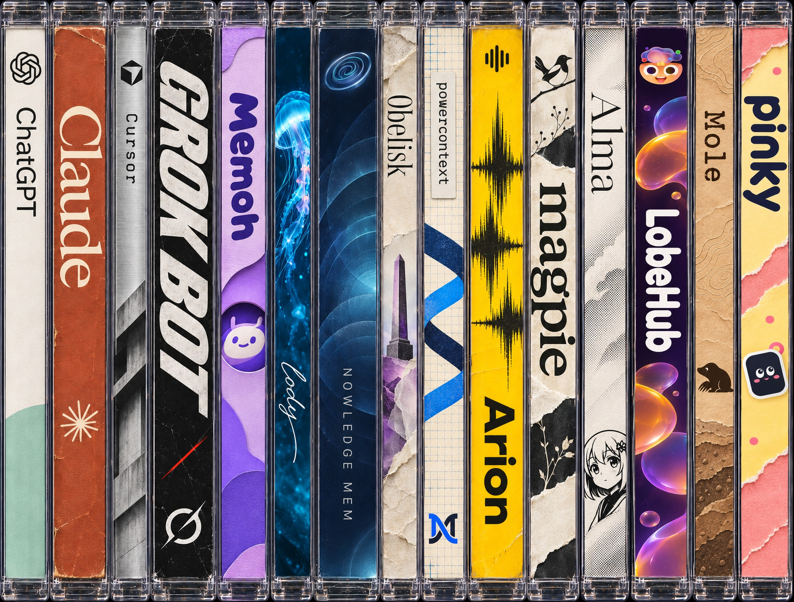
</p>

<details>
<summary><b>View individual CD spines (15 AI apps)</b></summary>

<br>

<p align="center">
  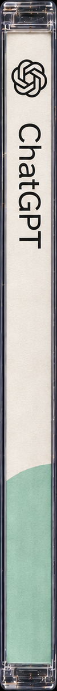
  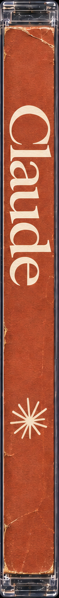
  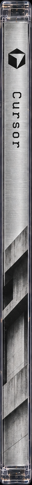
  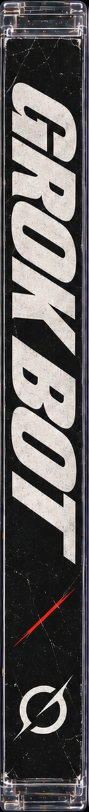
  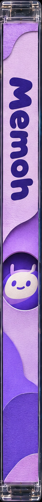
  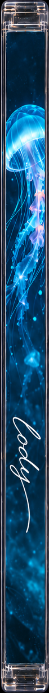
  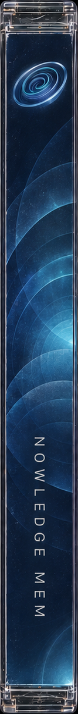
  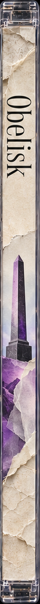
  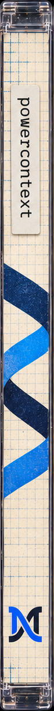
  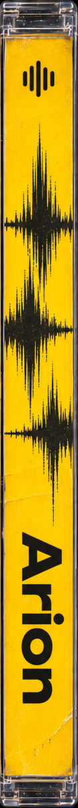
  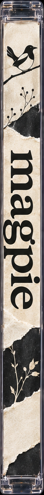
  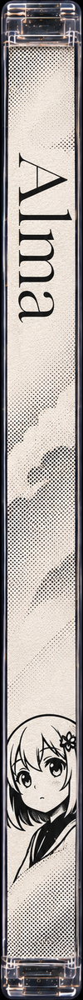
  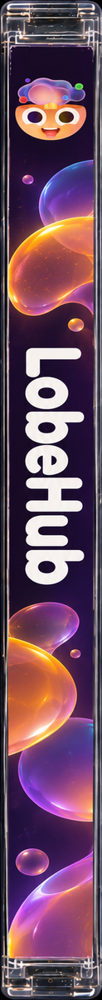
  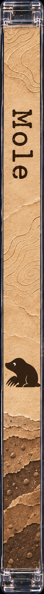
  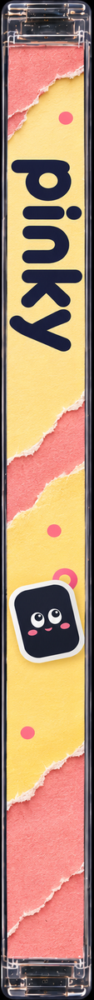
</p>

</details>

---

## Workflow

Feed look references—such as paper textures, album art, prior spines, and verified app marks—into your image tool's generation node. Generate one straight-on CD jewel case spine at a time, lying horizontally across the full width of a wide black canvas (such as `3840×1280`) at maximum quality. To revise a spine later, prompt an edit on that single generation while keeping the rest of the set untouched. Finally, measure tight pixel crops around each case, rotate horizontal strips 90° clockwise, and run `scripts/assemble.py` to stitch a uniform shelf collection.

---

## What It Does

`cd-spine-art` guides an AI agent through art-directing and assembling realistic CD jewel case side labels:

- **Authentic Brand & Visual Research**: Retrieves and visually verifies genuine logos/marks from official websites or repositories before generating artwork, avoiding hallucinated icons.
- **Bespoke Art Direction per Spine**: Independently tailors paper stock (parchment, grid paper, torn collage, halftone manga, brushed metal, distressed black), color palette, typography, and case width (`244–400 px` at `3600 px` height) to fit each subject's personality.
- **Consistent Physical Construction**: Keeps every spine grounded in the same straight-on transparent plastic jewel case aesthetic—clear rails, molded end tabs, subtle paper/plastic wear, and zero perspective distortion—so any set lines up cleanly on a shelf.
- **Precision Cropping & Shelf Assembly**: Includes `scripts/assemble.py` to crop out the black background, rotate horizontal source strips 90° clockwise, normalize heights (default `3600 px`), and export a composite `collection.png`, individual high-res PNGs, and `spines.zip`.
- **Incremental Collection Updates**: Retains existing spine exports when adding or editing items so you can grow a collection without regenerating everything.

---

## Installation

### Via Skills CLI (Recommended)

```bash
npx skills add stvlynn/cd-spine-art-skill
```

<details>
<summary>More Skills CLI options</summary>

```bash
# Install globally for your user profile and skip confirmation prompts
npx skills add stvlynn/cd-spine-art-skill --skill cd-spine-art -g -y

# Target specific agents (e.g., Cursor, Claude Code, Codex)
npx skills add stvlynn/cd-spine-art-skill --agent cursor claude-code

# Preview available skills in this repository before installing
npx skills add stvlynn/cd-spine-art-skill --list
```

</details>

### Runtime Requirements

- An agent/environment with an **image tool that accepts reference images** (for generating new spines; existing spine artwork can still be cropped and assembled without it).
- **Python 3** with **Pillow** installed for running the assembly script:
  ```bash
  pip install -r skills/cd-spine-art/scripts/requirements.txt
  ```

---

## Usage

Once installed, ask your agent in natural language or invoke `$cd-spine-art`:

> *"Use `$cd-spine-art` to turn Cursor, Claude, ChatGPT, and powercontext into a CD jewel case spine collection."*

> *"帮我把这几个 App 做成一排复古实体 CD 盒侧脊拼图：Cursor、Claude、LobeHub、Alma。"*

### Assembly Script (`scripts/assemble.py`)

You can also run the bundled assembler directly with a JSON manifest:

```bash
python3 skills/cd-spine-art/scripts/assemble.py manifest.json output --height 3600
```

Example `manifest.json`:

```json
[
  {
    "name": "The_Poles",
    "image": "sheets/the-poles.png",
    "crop": [80, 430, 3760, 850],
    "rotate": 90
  },
  {
    "name": "Cursor",
    "image": "Cursor.png",
    "width": 244
  }
]
```

Outputs written to `output/`:
- `output/collection.png` — Side-by-side shelf composite at uniform height.
- `output/spines/<name>.png` — Individual cropped & normalized PNGs.
- `output/spines.zip` — ZIP archive containing all individual spine PNGs.

---

## Repository Structure

```text
.
├── assets/
│   ├── ai-apps-cd-spines.jpg         # Assembled 15-spine showcase preview
│   └── spines/                       # Individual preview spines
└── skills/
    └── cd-spine-art/
        ├── SKILL.md                  # Core agent workflow & art direction instructions
        ├── agents/
        │   └── openai.yaml           # Agent display metadata & default prompt
        ├── assets/
        │   └── icon.svg              # Skill icon
        └── scripts/
            ├── assemble.py           # Crop, rotate, resize & shelf-assembly script
            └── requirements.txt      # Pillow
```
