<div align="center">

# 💿 CD Spine Art (`cd-spine-art`)

**把 App 与专辑做成复古实体 CD 盒侧脊收藏图。**<br>
**Turn apps & albums into physical CD jewel case spine collections.**

[](https://github.com/vercel-labs/skills)
[](skills/cd-spine-art/SKILL.md)

[English](README.md) · 中文文档

</div>

---

## 效果与预览（Showcase）

将你常用的 AI 应用、开发者工具、音乐专辑或个人项目，重塑为一排充满千禧年实体媒介质感的 **透明塑料 CD 盒侧脊收藏架**：

<p align="center">
  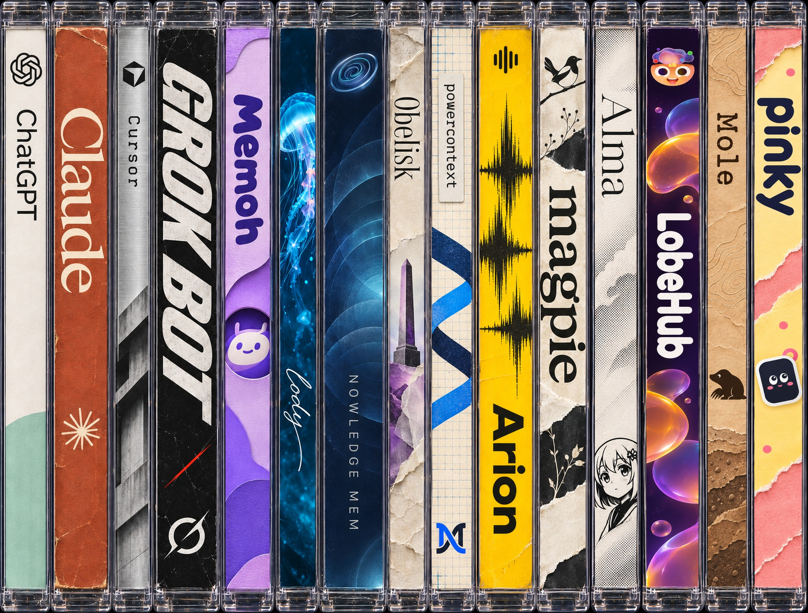
</p>

<details>
<summary><b>展开查看单张侧脊大图（15 款 AI 应用示例）</b></summary>

<br>

<p align="center">
  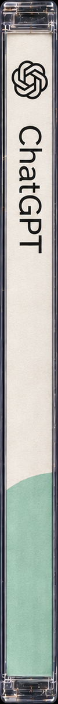
  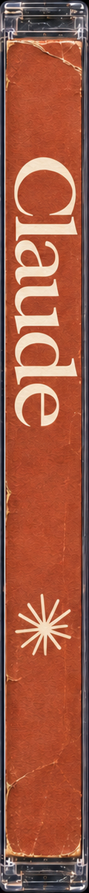
  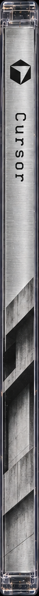
  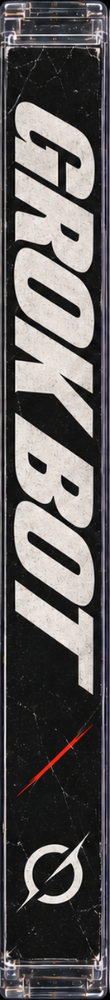
  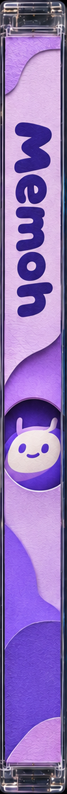
  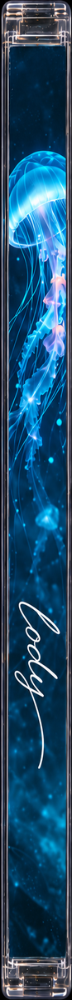
  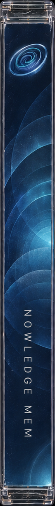
  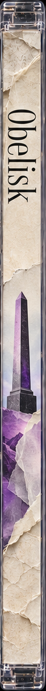
  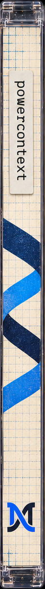
  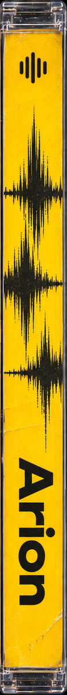
  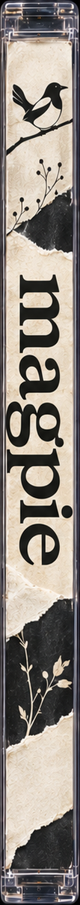
  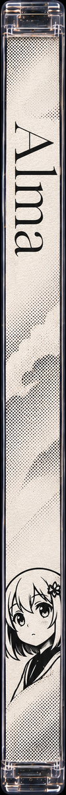
  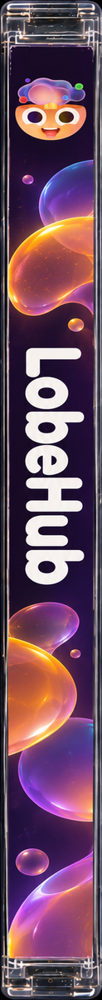
  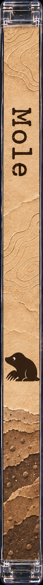
  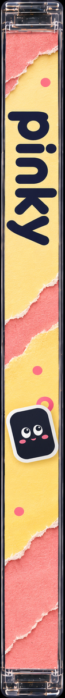
</p>

</details>

---

## 核心效果与特性

`cd-spine-art` 会引导 AI Agent 完成从品牌考据、独立美术指导到高精度裁切拼合的完整工作流：

- **真实品牌标识考据**：针对真实 App 或开源项目，先从官网或官方仓库检索并核对真实 Logo / 图形标识作为参考输入，避免凭空捏造图标。
- **逐张定制美术风格**：根据每个主题的气质，独立设计纸张材质（做旧羊皮纸、工程方格纸、撕纸拼贴、漫画网点、拉丝金属、磨损黑卡等）、色彩搭配、字体排版与盒体宽度（默认 `3600 px` 高度下约 `244–400 px` 宽）。
- **统一的实体塑料盒物理质感**：所有侧脊保持一致的正视无透视透明 CD 盒结构——清晰的透明导轨、上下两端完整的注塑卡扣、微妙的纸张折痕与外壳磨损，确保排成一排时严丝合缝。
- **像素级裁切与自动合集拼接**：内置 `scripts/assemble.py`，自动裁掉外部黑边间隔、顺时针旋转横向原图、统一缩放到相同高度（默认 `3600 px`），一次输出完整书架横幅 `collection.png`、单张高清 PNG 以及打包好的 `spines.zip`。
- **增量扩充收藏**：新增或修改单张侧脊时保留已有导出成品，只重绘新增或需调整的条目。

---

## 安装方式（通过 Skills CLI）

### 使用 `skills` CLI 一键安装（推荐）

```bash
npx skills add stvlynn/cd-spine-art-skill
```

<details>
<summary>更多安装参数示例</summary>

```bash
# 全局安装并跳过确认提示
npx skills add stvlynn/cd-spine-art-skill --skill cd-spine-art -g -y

# 指定安装到特定 Agent（如 Cursor、Claude Code、Codex）
npx skills add stvlynn/cd-spine-art-skill --agent cursor claude-code

# 安装前预览仓库内包含的 Skill
npx skills add stvlynn/cd-spine-art-skill --list
```

</details>

### 运行依赖

- **图像生成工具**：Agent 需具备生图能力以绘制新的侧脊原图（若已有现成侧脊图片，仅做裁切与拼接则无需生图工具）。
- **Python 3 + Pillow**：用于执行自动裁切与拼接脚本：
  ```bash
  pip install Pillow
  ```

---

## 使用示例

安装完成后，直接在对话中提及需求或调用 `$cd-spine-art` 即可：

> *"帮我用 `$cd-spine-art` 把 Cursor、Claude、ChatGPT、LobeHub、Alma 做成一排实体 CD 盒侧脊收藏图。"*

> *"往刚才那组 CD 盒收藏里再加一张 powercontext，保持高度一致重新拼好。"*

### 独立运行拼接脚本（`scripts/assemble.py`）

```bash
python3 skills/cd-spine-art/scripts/assemble.py manifest.json output --height 3600
```

`manifest.json` 示例：

```json
[
  {
    "name": "ChatGPT",
    "image": "sheet_01.png",
    "crop": [40, 0, 340, 3600]
  },
  {
    "name": "Cursor",
    "image": "Cursor.png",
    "width": 244
  }
]
```

执行后会在 `output/` 目录生成：
- `output/collection.png` — 等高无缝并排拼接的完整收藏横幅图
- `output/spines/<name>.png` — 每张独立裁切与标准化后的侧脊 PNG
- `output/spines.zip` — 所有单张侧脊 PNG 的压缩包

---

## 目录结构

```text
.
├── assets/
│   ├── ai-apps-cd-spines.jpg         # 15 款 AI 应用侧脊拼接总览图
│   └── spines/                       # 单张侧脊效果预览图
└── skills/
    └── cd-spine-art/
        ├── SKILL.md                  # Skill 核心工作流与美术规范说明
        ├── agents/
        │   └── openai.yaml           # Agent 界面配置与默认提示词
        ├── assets/
        │   └── icon.svg              # Skill 图标
        └── scripts/
            └── assemble.py           # 裁切、旋转、等高缩放与拼接脚本
```
